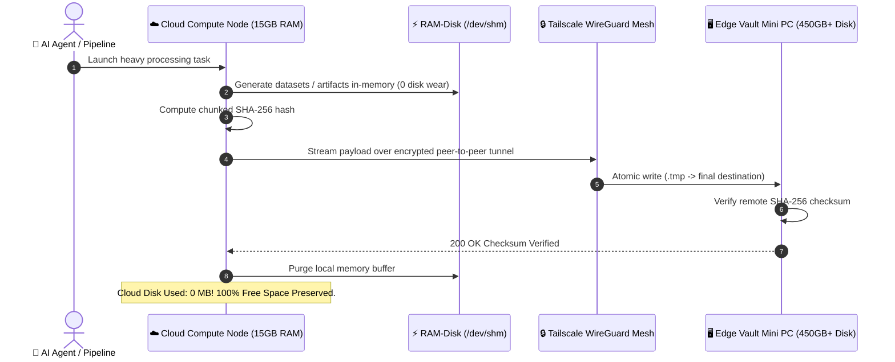

# 🌌 Hybrid Mesh Vault: Zero-Cost Disaggregated Compute & Storage for AI Agents & Homelabs

[](https://opensource.org/licenses/MIT)
[](https://tailscale.com)
[]()
[]()
[](skills/hybrid-mesh-vault/SKILL.md)
[](https://github.com/PabloIan92/infinite-ai-mesh)

### **Process in 15GB Cloud RAM. Store in 500GB+ Edge Homelab. 100% $0/month Sovereign Infrastructure.**

> *"Why pay $50/month for expanded cloud block storage when your homelab mini PC has 500GB of empty NVMe storage? And why choke your homelab with heavy model quantization and dataset processing when your free cloud VPS has 15GB–24GB of RAM? Disaggregate compute from storage over an encrypted WireGuard mesh."*

[⚡ Quickstart (1-Minute Setup)](#-quickstart--turnkey-deployment) • [🏛️ Architectural Specification](#-the-asymmetric-node-dilemma) • [📊 Live Telemetry](#-live-cluster-telemetry--verified-benchmarks) • [🤖 Agent Skill Integration](#-agent-skill-integration-claude--antigravity--opencode) • [🔗 Infinite AI Mesh Companion](#-ecosystem-synergy-infinite-ai-mesh)

---

## ⚡ The Asymmetric Node Dilemma

Indie developers, homelab enthusiasts, and AI engineers face a frustrating resource mismatch:

| Node Type | Compute & RAM 🚀 | Storage Capacity 📦 | Network & Uptime 🌐 | The Dilemma |
|---|:---:|:---:|:---:|---|
| **Cloud VPS** *(e.g. Oracle Cloud Free Tier)* | **15 GiB – 24 GiB RAM**<br>High-speed CPU | **Small (40–50 GB total)**<br>*(~18 GB free)* | 24/7 High Uptime<br>Gigabit symmetric uplink | Runs out of disk space during dataset builds, video rendering, and database backups (`No space left on device`). |
| **Edge Node** *(e.g. Mini PC, NUC, Homelab NAS)* | **3.8 GiB – 8 GiB RAM**<br>Resource-constrained | **Huge (500 GB – 4 TB)**<br>*(400+ GB empty)* | Domestic Dynamic IP<br>Behind NAT / CGNAT | Cannot run heavy memory-hungry pipelines without freezing or triggering Linux OOM Killer. |

**The Traditional "Solutions":**
1. 💸 **Pay monthly cloud storage upgrades**: $10–$50/month for cloud block volumes.
2. ⚠️ **Expose home ports to the public internet**: Dangerous firewall port forwards and Dynamic DNS setups.
3. ❌ **Run everything locally**: Overheats low-RAM mini PCs and kills background tasks.

---

## 🛡️ The Solution: Disaggregated Cloud-Edge Architecture

**Hybrid Mesh Vault** bridges these two worlds into a single, cohesive distributed system:



### Core Architectural Pillars

1. **Zero-Copy Memory Ingestion (`/dev/shm`)**:
   Pipelines generate intermediate artifacts directly in Linux shared RAM. Zero wear on NVMe flash, microsecond read/write performance.
2. **End-to-End WireGuard Mesh Encryption**:
   Direct peer-to-peer transport over Tailscale. Works across NAT and CGNAT with zero open ports exposed to the public internet.
3. **Atomic Writes & SHA-256 Checksum Guarantees**:
   Target files are written to `.tmp` files and only promoted upon strict cryptographic hash equality.
4. **Automatic Cloud Purge**:
   The cloud node immediately unlinks the source artifact once receipt and hash are confirmed by the edge vault. Zero cloud disk footprint.

---

## 📊 Live Cluster Telemetry & Verified Benchmarks

Real telemetry captured on our production cluster (Oracle Cloud 15GB RAM + Intel NUC 458GB Edge Vault):

```text
==============================================================
 🌌 HYBRID MESH VAULT: CLUSTER TELEMETRY
==============================================================
 Node: cloud-compute-worker (100.64.0.1)
 Role: COMPUTE_PRIMARY
--------------------------------------------------------------
 RAM:  14.12 GB available / 15.61 GB total
 SHM:  7.81 GB available in /dev/shm (RAM-Disk)
 Disk: 18.92 GB free / 44.07 GB total (57.0% used)
--------------------------------------------------------------
 🛰️ Edge Vault Peer: vault-user@100.64.0.2:/mnt/mesh_vault_storage
 Status: ONLINE (RTT: 31.4 ms via Tailscale Direct Peer)
 Remote Disk: /dev/sda2       458G   11G  425G   3% /
==============================================================
 🎯 Cluster Unified Architecture: ACTIVE
    Compute/RAM Engine: Cloud Node (15 GB RAM)
    Storage Vault:      Edge Mini PC (425 GB Free Disk)
==============================================================
```

### Verified End-to-End Benchmark Run

```bash
mesh-vault benchmark --size-mb 10
```

```text
⚡ Running Hybrid Mesh Vault End-to-End Benchmark (10 MB)...
 1. Generating 10 MB synthetic payload in RAM (/dev/shm)... Done in 0.009s
 2. Offloading from Cloud RAM to Edge Vault via Tailscale... Done in 2.102s (4.76 MB/s)
 3. Fetching back from Edge Vault into Cloud RAM (/dev/shm)... Done in 2.089s (4.79 MB/s)

==============================================================
 🏆 BENCHMARK RESULTS
==============================================================
 Payload Size:       10 MB
 Offload Throughput: 4.76 MB/s
 Fetch Throughput:   4.79 MB/s
 SHA-256 Checksums:  MATCH (100% Cryptographic Integrity)
 Cloud Disk Used:    0 MB (Zero disk bleed)
==============================================================
```

---

## ⚡ Quickstart & Turnkey Deployment

### 1. Prerequisites
- Two Linux machines (Cloud VPS + Local Edge machine).
- [Tailscale](https://tailscale.com) authenticated on both nodes.
- SSH keys configured for passwordless connection between nodes over Tailscale.

### 2. One-Line Turnkey Installation
Clone and install on your Cloud Compute node:

```bash
git clone https://github.com/PabloIan92/hybrid-mesh-vault.git
cd hybrid-mesh-vault
chmod +x scripts/install.sh
sudo ./scripts/install.sh
```

### 3. Verify Cluster Telemetry
```bash
mesh-vault status
```

### 4. Basic CLI Operations

```bash
# Offload a heavy file to Edge Vault (automatically purges local copy)
mesh-vault offload /path/to/heavy_model.bin --subdir models

# List stored files inside Edge Vault
mesh-vault list --subdir models

# Fetch file back directly into Cloud RAM (/dev/shm)
mesh-vault fetch heavy_model.bin --subdir models --target-dir /dev/shm

# Run an automated end-to-end benchmark
mesh-vault benchmark --size-mb 10
```

---

## 🤖 Agent Skill Integration (Claude / Antigravity / OpenCode)

`hybrid-mesh-vault` comes pre-packaged as a specialized **Agent Skill** in [skills/hybrid-mesh-vault/SKILL.md](skills/hybrid-mesh-vault/SKILL.md).

When installed in your agent environment (`~/.claude/skills/` or `~/.agents/skills/`), your autonomous agents gain the intelligence to preserve disk space autonomously:

```python
from mesh_vault.offload import offload_file
from mesh_vault.fetch import fetch_file

# Example: Agent generates a database dump or video output
receipt = offload_file(
    local_path="/dev/shm/daily_backup.tar.gz",
    target_subdir="backups/oracle_cloud",
    purge_local=True
)

print(f"Agent Offload Verified: {receipt['remote_path']} (SHA: {receipt['sha256'][:8]}...)")
```

---

## 🔗 Ecosystem Synergy: Infinite AI Mesh

`hybrid-mesh-vault` is designed to seamlessly pair with [PabloIan92/infinite-ai-mesh](https://github.com/PabloIan92/infinite-ai-mesh):

| Capability | **Infinite AI Mesh** 🌌 | **Hybrid Mesh Vault** 📦 |
|---|---|---|
| **Primary Focus** | 24/7 Sovereign Multi-Engine AI Compute & Failover | Disaggregated Cloud RAM + Edge Homelab Storage |
| **Failover Layer** | Antigravity -> NVIDIA NIM -> Local 14B -> DeepSeek | Cloud RAM Buffer -> Tailscale Mesh -> Edge Vault |
| **Storage Role** | In-Memory Ephemeral Agent Session Context | Permanent Multi-Terabyte Cold Storage Archive |
| **Total Combined Cost** | **$0.00 / month** | **$0.00 / month** |

Together, they form a **complete, unkillable, self-hosted AI operating system**: Infinite compute availability in the cloud without token fees, and infinite storage capacity on local edge hardware without cloud disk upgrade costs.

---

## 📜 License

Released under the **MIT License**. Copyright (c) 2026 Pablo Ian Laurino ([@PabloIan92](https://github.com/PabloIan92)).
Contributions, issues, and PRs are welcome!
